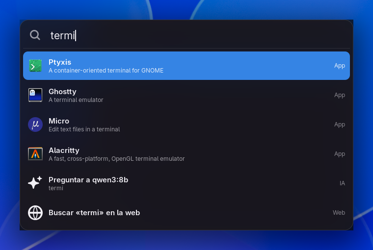
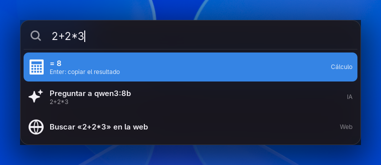
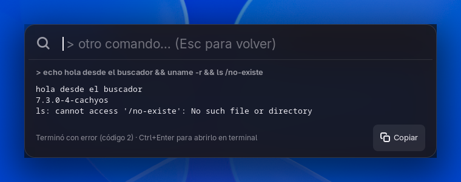
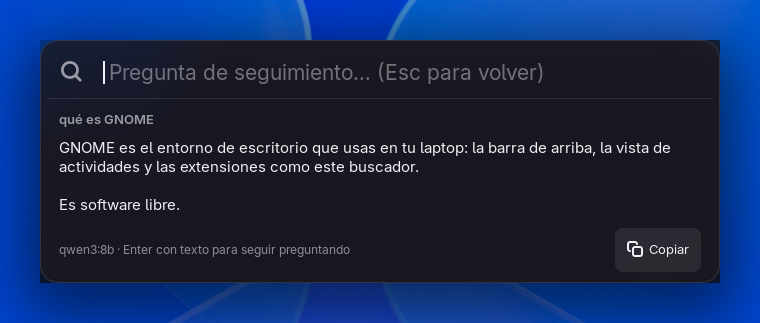
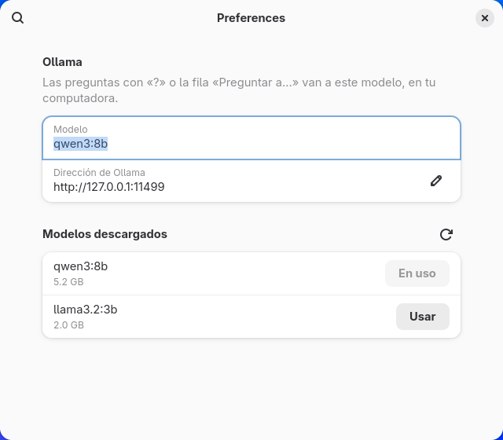

# Buscador

Extensión de GNOME con un buscador al centro de la pantalla, al estilo de Spotlight de macOS.
Pulsa **Super + Espacio** y escribe: abre apps y archivos, hace cuentas, corre comandos y le
pregunta a un modelo de IA local con [Ollama](https://ollama.com/), sin internet y sin cuenta.



| Cuentas | Comandos | Preguntas a la IA |
|---|---|---|
|  |  |  |

## Qué hace
- **Apps:** las mismas que encuentra GNOME, ordenadas por las que más usas.
- **Archivos y carpetas:** con LocalSearch, el índice que GNOME ya mantiene (el mismo de Archivos).
  Enter abre el archivo; **Ctrl+Enter** abre la carpeta donde está.
- **Cuentas:** `2+2*3`, `2^10`, `15% de 300`, `sqrt 81`, `(1+2)*3`. Enter copia el resultado.
- **Acciones del sistema:** bloquear, suspender, reiniciar, apagar, cerrar sesión, captura de pantalla.
- **Comandos:** empieza con `>`. `> df -h` lo corre ahí mismo y muestra lo que imprime (se corta a
  los 15 s). **Ctrl+Enter** lo abre en una terminal nueva (Ghostty, Ptyxis, Consola o GNOME Terminal).
  Después puedes escribir otro comando y Enter.
- **Preguntas a la IA:** empieza con `?`, o elige la fila «Preguntar a…» que sale en toda búsqueda.
  La respuesta aparece conforme el modelo la escribe. Lo que escribas después es una pregunta de
  seguimiento: el modelo recuerda la conversación hasta que pulses Escape.
- **Buscar en la web:** la última fila abre la búsqueda en tu navegador.

## Teclas
| Tecla | Qué hace |
|---|---|
| Super + Espacio | Abre o cierra el buscador |
| ↑ ↓ (o Tab, Ctrl+N, Ctrl+P) | Elige resultado |
| Enter | Abre el resultado |
| Ctrl + Enter | Archivo: abre su carpeta. Comando: lo abre en una terminal |
| Escape | Sale de la respuesta; si no, borra el texto; si está vacío, cierra |

Clic fuera de la caja también la cierra.

## Instalar
```bash
git clone https://github.com/DimitriMedNov/buscador.git
cd buscador
./install.sh
```
Cierra sesión y vuelve a entrar. Funciona en GNOME 48 a 51.

**Ojo con el teclado:** en GNOME, Super + Espacio cambia el idioma del teclado. El instalador mueve
ese cambio a **Alt + Shift** para dejarle Super + Espacio al buscador. `./install.sh --quitar` quita
la extensión y regresa Super + Espacio al cambio de idioma.

## IA con Ollama
El buscador funciona sin Ollama; solo la parte de preguntas lo necesita.

```bash
sudo pacman -S ollama-vulkan        # Arch; Vulkan aprovecha gráficas AMD/Intel integradas
sudo systemctl enable --now ollama
ollama pull qwen3:8b                # unos 5 GB
```

De fábrica usa `qwen3:8b`. Para cambiar de modelo:
`gnome-extensions prefs buscador@dimitrimednov.github.io`. Ahí salen los modelos que ya
descargaste para elegir uno con **Usar**.



La primera pregunta tarda más porque Ollama carga el modelo en memoria; el buscador te avisa. Si
Ollama no está corriendo o falta el modelo, te dice qué pasó, cómo arreglarlo y te da **Reintentar**.

## Cambiar el atajo
```bash
gsettings --schemadir ~/.local/share/gnome-shell/extensions/buscador@dimitrimednov.github.io/schemas \
  set org.gnome.shell.extensions.buscador atajo "['<Super>Return']"
```

## Licencia
MIT
